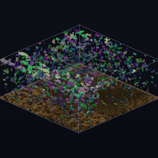
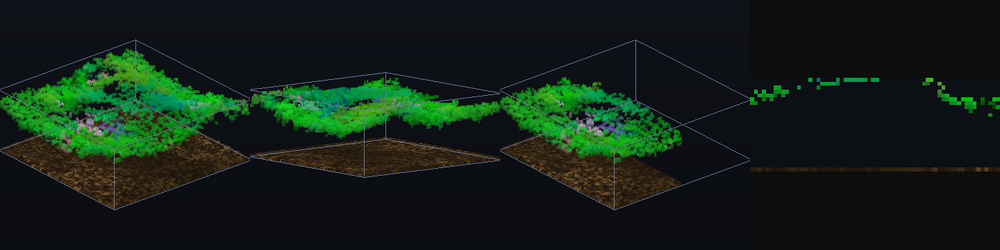
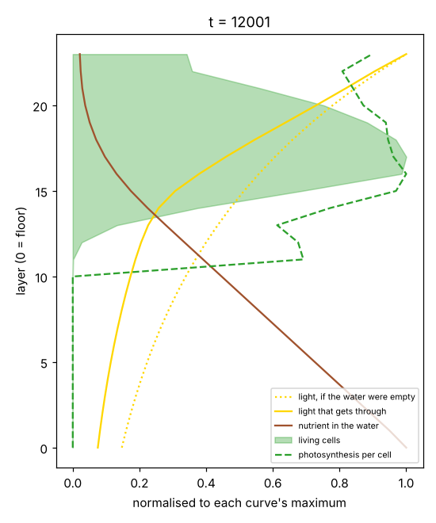
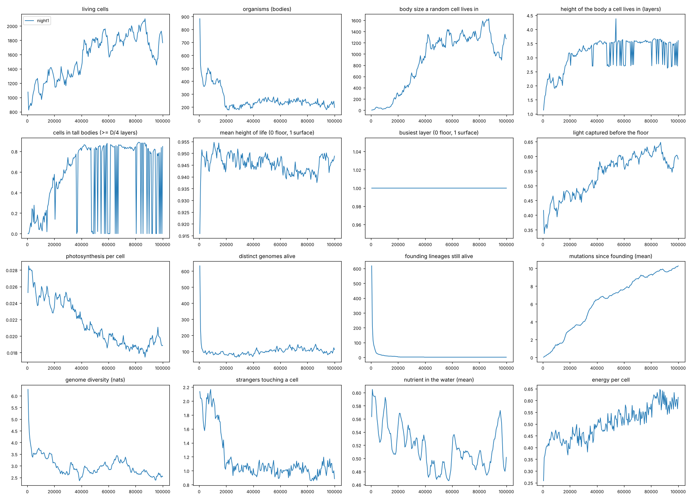
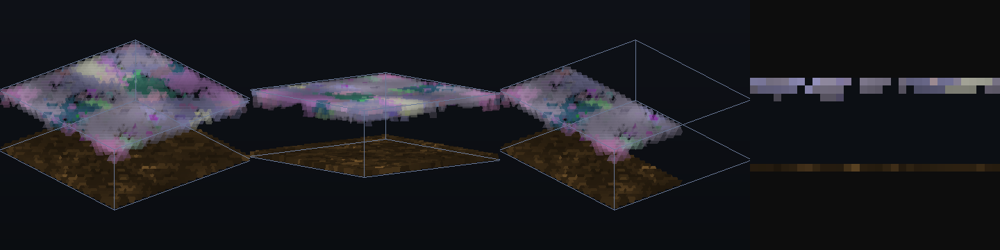
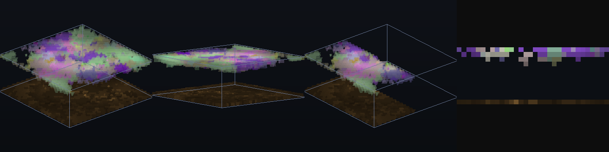
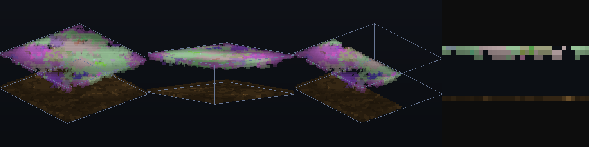
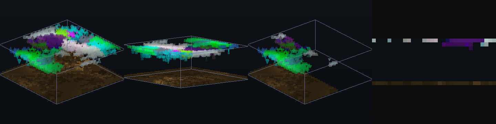

# Emergence3D

**[Emergence](https://github.com/anttiluode/Emergence), moved into a box of water.** Genomes are
token sequences, a fixed random transformer reads them, and the cells it builds live, take up
nutrient, photosynthesise, share, steal, signal, divide, die and evolve, now on a 3D grid. As in
Emergence, the machinery is designed (cells, bodies, sharing, attaching, dividing), but what it
builds is not. No shape, organism, plant or layer is scripted.




*From the left: the box from above and from below, the box cut open, and a vertical slice.
Cells are coloured by lineage and lit by the light that actually reaches them. The sand on the
floor is lit the same way, so the life above casts its shadows on it.*

## What is new in 3D: the two things life needs come from opposite ends

```
            moving suns over a dim sky
   ─────────────────────────────────────────  surface
     LIGHT falls down; water dims it with depth,
     and every cell it crosses absorbs part of it
     (a cell above another cell shades it)
                        │
                        ▼
     a cell makes energy only from light AND nutrient together
     (photosynthesis); body-mates share both
                        ▲
                        │
     NUTRIENT seeps up from the floor, is taken up,
     and returns to the water where a cell dies
   ─────────────────────────────────────────  floor (unlimited nutrient reservoir)
```

Both rules are physics of the box, not rules for organisms. Light is the moving suns of
Emergence, shining from above and shaded by whatever lives in the column. Nutrient is a field
fed by the floor. Energy made per step is `photo_yield × absorbed light`, limited by the nutrient
the cell holds (`n_per_e` per unit of energy). So near the surface there's light but the
nutrient runs out; near the floor there's nutrient but no light. Whatever life does about that
(stay in one layer, follow the suns, or grow bodies tall enough to reach both) is up to
selection.

Everything else is Emergence with six neighbours instead of four:

```
 genome tokens ──► TRANSLATOR (fixed random transformer) ──► phenotype (gains & biases)
      ▲               reads the genome + a STATE token          │
      │ mutation       (how the lineage is doing now)            ▼
      │                          ▲                     CELL NETWORK (shared, fixed, 45 → 48 → 23)
      └──── births ◄─────────────┴──── 3D WORLD (torch) ◄────────┘
```

## Run it

```
pip install -r requirements.txt       # see the GPU note below
python -c "import torch; print(torch.cuda.is_available())"     # must say True to use the GPU
python run.py                         # live viewer, box 40 deep x 144 x 144
python run.py --depth 48 --size 192   # bigger box
python run.py --headless --steps 500000 --out runs/night1 --video      # overnight
python run.py --load runs/night1/ckpt_0500000.pt                       # open it in the viewer
python plot.py runs/night1            # metrics.png
python inspect_world.py runs/night1/ckpt_0500000.pt                    # who is alive, at what height
python profile.py runs/night1/ckpt_0500000.pt                          # cells, light and nutrient by depth
```

**GPU note.** On Windows, a plain `pip install torch` installs a CPU-only build, and the world then
runs on the CPU. The first line `run.py` prints shows which device is in use (`device=cpu` or
`device=cuda`). To use an NVIDIA card, uninstall torch and install a CUDA build with the command
pytorch.org's install selector gives, for example
`pip install torch --index-url https://download.pytorch.org/whl/cu126`.

**Viewer:** drag the mouse to turn the box, wheel to zoom, `O` for a slow automatic orbit.
`TAB` switches between the 3D view, a vertical slice and a horizontal slice. `C` cuts the box
open (front half, side half, or the top layers removed) and `[` `]` move the cut, or the slice.
`,` `.` make cells more or less see-through, `G` changes render resolution. `1`–`8` are the views:
life, bodies, clades, light, nutrient, photo (energy made last step), energy, age. In a slice,
left drag wipes a ball of cells (damage: does anything repair?), `F` then drag pours nutrient,
right click shows a genome. `SPACE` pauses, `+` `-` change steps per frame, `R` drops 500 random
cells, `S` saves, `P` screenshots, `V` records video.

Every law is a field in [`emergence3d/config.py`](emergence3d/config.py) and can be changed from
the command line, e.g. `--set share_rate=0 --set cell_shade=0`.

## What is in the world

**A cell** is one occupied voxel. Each step it perceives its 8 private state channels; its
energy, nutrient and age; the nutrient in the water and its 3D gradient; the light reaching it;
4 diffusing signals and their gradients; its neighbours' mean state; and how many of its six
neighbours are body-mates, strangers, strangers with its own genome, or empty (45 inputs). One
shared network with fixed random weights maps this to 23 action outputs, with each lineage's
phenotype rescaling and shifting the hidden units and biasing the outputs.

**Actions:** update private state; emit 4 signals; take up nutrient; share energy and nutrient
with body-mates; steal energy from strangers; divide into one of six directions (up and down
included); and whether the child stays attached to the parent's body.

**Bodies, genomes, mutation, ageing, the translator and the STATE token** are the same as in
Emergence. The STATE token now carries the lineage's mean private state, energy, nutrient, the
light it gets, how surrounded by body-mates it is, and its size. `--set regulation=0` cuts that
feedback loop.

**Conservation:** energy enters only through photosynthesis and leaves through metabolism,
signalling and attacks (stealing loses 30%). Nutrient is conserved except at the floor, which
exchanges with an unlimited reservoir. A dying cell returns its nutrient and part of its energy
(as nutrient) to the water where it was.

## What a small CPU run showed

One run on two CPU cores: a box 24 deep × 64 × 64, seed 0, 12,000 steps, default laws. Treat
it as an observation, not a result. ([metrics](docs/metrics.png), [orbit](docs/orbit.gif))

The defaults were set by three short calibration runs on a 24 × 48 × 48 box. With clear water
(70 % of the sky reaching the floor) life simply sank toward the nutrient. Murkier water
(`water_clarity` 0.5, so about 14 % reaches the floor), a higher `photo_yield` (0.12) and faster
nutrient diffusion (0.6) gave a world that kept going with more of the box in use. Those three
values are the only tuning.



- **A living layer forms below the surface.** Life starts packed at the top (busiest layer at
  0.96–1.0 of the height by step 1,000), uses up the nutrient there, and sinks to about
  0.70–0.78 of the height, where it stays. At step 12,000 cells are densest at layers 16–18 of
  23. Above them the nutrient is used up (0.02 at the surface); below them the light is.
  Nothing lives under layer 11, although the nutrient there is 3–10× richer. That is the
  *compensation depth*: below it, the light a cell can absorb makes less energy than it burns.
  This is the deep chlorophyll maximum, coming straight out of the physics of the box. It's
  expected, not a discovery.
- **Life shades itself and the floor.** The share of the light that would have reached the
  floor and is caught on the way rose from 36 % to 49 %. The floor in the snapshot shows the
  shadows.
- **Bodies get taller, slowly.** The height of the body a cell lives in rose from 1.9 to 3.2
  layers. Cells in bodies at least 6 layers tall (a quarter of the box) went from 1 % to 19 %,
  much of it in the last 1,500 steps, so this is not settled. Half the cells live in bodies of
  8 or more (largest 212). Nothing reaches down into the dark, nutrient-rich water: no "plant"
  with roots, at least not yet.
- **Selection is strong.** 419 founding lineages became 12. The most common genomes all
  descend from one clade (351), and they share a bias: dividing *down* is favoured (+0.13 to
  +1.34) and dividing *up* is suppressed (−1.37 to −1.49), while children stay attached
  (detach −1.0 to −1.5). That's a lineage that grows downward out of the bright layer toward
  the nutrient, in attached bodies. One run, no controls, so it's a lead, not a finding.
- **Everything is green by accident.** Lineage colour is a random readout of the phenotype,
  and the winning clade happens to read out green. It has nothing to do with chlorophyll.
- **Population** grew from 3,800 to 6,100 cells, about 6 % of the box.

## The long run: a shallow box, 100,000 steps

Antti's overnight run: a box 12 deep × 32 × 32 (12,288 voxels), seed 0, default laws, 100,000
steps on CPU (`device=cpu` in the log, 28 steps per second). Files: [log](docs/longrun/log.txt),
[config](docs/longrun/config.json), [metrics](docs/longrun/metrics.csv).



Four snapshots from the run, in the order they were sent. Each one shows, from the left: the box
from above, from below, cut open, and a vertical slice.






What happened, from the metrics:

| | step 500 | step 20,000 | step 100,000 |
|---|---|---|---|
| cells | 1,076 | 1,240 | 1,764 |
| founding lineages | 618 | 3 | **1** (from step ~40,000 on) |
| genomes alive | 633 | 79 | 111 |
| body size a random cell lives in | 1.5 | 275 | **1,270** |
| largest body | 8 | 553 | **1,496** (85 % of all cells) |
| strangers touching a cell | 2.1 | 1.1 | 0.9 |
| body-mates touching a cell | 0.4 | 2.6 | 3.5 |
| light caught before the floor | 42 % | 47 % | 59 % |
| photosynthesis per cell | 0.025 | 0.024 | 0.019 |
| energy per cell | 0.26 | 0.40 | 0.61 |
| mutations since founding (mean / max) | 0.03 / 1 | 3.1 / 5 | 10.3 / 17 |

- **One organism took the surface.** One founding lineage won, and its cells stayed attached
  until a single body held about 85 % of all living cells: a mat 2–4 layers thick covering the
  top of the box. Bodies merged in the same window as the lineages died out (steps 15,000–40,000).
- **It's very likely a genetic mosaic.** Mutation at birth gives a child a new genome, but the
  child stays in its parent's body. With one clade, around 100 genotypes alive and 85 % of
  cells in one body, most of those genotypes have to sit inside the mat. The patchwork of
  colours in the snapshots is consistent with that (colour follows genome, not body). Opening
  the last checkpoint in the viewer and comparing view `2` (bodies) with view `1` (life) would
  confirm it.
- **The mat gets better at catching light and shares it.** It caught 42 % → 59 % of the light
  that would have reached the floor. Each cell makes less (shading inside the mat), yet each cell
  holds more energy (0.26 → 0.61). That's what you'd expect if body-mates pool energy, but
  `--set share_rate=0` is the control that would test it.
- **No deep living layer, and that's expected for this depth.** With only 12 layers the
  nutrient reaches the surface (about 0.5 throughout the water, all run long), so light is the
  only thing in short supply and life sits at the very top. The busiest layer is the surface
  for all 100,000 steps. The 24-deep CPU run above, where the nutrient runs out before the
  surface, is the regime with the floating layer.
- **The "tall" metric flickers, and it's an artefact.** `tall_fraction` jumps between 0 and
  0.85 from step ~37,000 on, and the body height between 2.7 and 3.6. Nearly every cell is in
  one body, and that body sits right at the 4-layer threshold (a quarter of 12). Whenever a
  few of its cells hang down into the 4th layer (the spikes under the mat in snapshot d), the
  whole body counts as tall. That's one bit about one body, not a population of tall organisms.
- **A dip and recovery near the end.** Between steps 85,000 and 95,000 the population fell from
  ~2,100 to ~1,450, the mat shrank, and both recovered. These metrics can't say why.

The first three rows of the original `metrics.csv` belong to an earlier start at the default box
(19,652 cells at 0.9 steps per second, on CPU), written to the same folder. They're left out
here.

Not shown by this run: anything about the 3D-specific question (bodies spanning from nutrient
into light), because in a 12-deep box there's no gap to span. For that, the box has to be deep
enough that the nutrient runs out before the surface, about 24 layers or more at these laws.

## What to look for, and how to know it is real

| question | how to ask it |
|---|---|
| Do tall bodies ("plants") appear that reach from the nutrient into the light? | `body_height_cellweighted` and `tall_fraction` over a long run; the cut-open view |
| Is that height functional? | `--set share_rate=0`: if bodies are as tall without sharing nutrient up and energy down, the height is just clonal stacking |
| Where does life settle in depth, and does it move? | `mean_height`, `living_layer`; compare with the light and nutrient views |
| Does shading matter (canopies, life in the shadow of others)? | `--set cell_shade=0` (cells stop shading each other) |
| Does gene regulation matter? | same seed with `--set regulation=0`; `python plot.py runs/a runs/b` |
| Repair | in a slice view, wipe a hole through a large body. Does the same body regrow it? |
| Do lineages follow the suns in 3D, sideways and up and down? | the light view, then the life view, over time |

`plot.py` overlays several runs, so each control is one extra command.

## Speed

Measured on CPU only (two cores, PyTorch 2.15): about 13 steps per second for 55,000 voxels
(24 × 48 × 48) and 8 per second for 98,000 (24 × 64 × 64), including logging, snapshots and
video. The default box (40 × 144 × 144) is 830,000 voxels. The GPU speed is not measured; on an
RTX 3060 I'd expect tens of steps per second, but that's a guess. The renderer ray-marches about
two samples per voxel of the box diagonal for every pixel; `G` lowers the resolution if the
viewer feels slow.

## Prior work (fences, not novelty claims)

Emergence (the parent repo, with its own list); Karl Sims' evolved 3D creatures (1994);
Framsticks; Avida and Tierra; growing 3D neural cellular automata (Sudhakaran et al., 2021);
3D Lenia and Flow-Lenia; ALIEN. In real oceans, phytoplankton face exactly this light-from-above,
nutrient-from-below trade, and often gather in a *deep chlorophyll maximum*: a living layer at
the depth where the two meet. Nothing here models real plankton. But if a living layer appears
in this box at an intermediate depth, that is the known physics of the setup, not a discovery.

## Not claimed

- That anything here is alive, or that the observations below replicate on other seeds.
- That the living layer is anything beyond the expected physics of light from above and
  nutrient from below.
- That the transformer "understands" genomes. It is a fixed random map, and evolution finds the
  texts that map to good phenotypes.
- That sharing, regulation or shading matter. None of the controls above has been run.
- That it runs fast on a GPU. The code is device-agnostic but was tested on CPU only.

## Files

```
emergence3d/config.py       every law of the world
emergence3d/world.py        the 3D box: light, nutrient, cells, bodies, physics, metrics, save/load
emergence3d/render.py       colour volumes, the ray-marched orbit view, slices
emergence3d/genome.py       token genomes on the GPU (from Emergence, unchanged)
emergence3d/translator.py   the transformer that turns genomes into phenotypes (from Emergence, unchanged)
run.py                      viewer and headless runner
plot.py                     metric plots, several runs overlaid
inspect_world.py            top genomes, their bodies, heights and biases, ancestry chains
profile.py                  cells, light, nutrient and photosynthesis by depth
```

Built by Claude (Opus 5.5).
